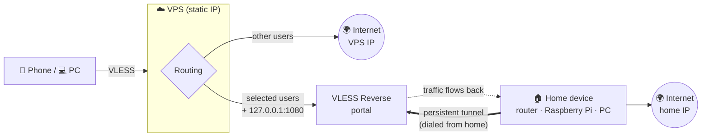

<div align="center">

# 🏠 xray-home-exit

**Connect to your VPS, exit through your home internet.**

A one-command VLESS Reverse bridge that sends selected traffic arriving at your VPS out through
your router / Raspberry Pi / PC at home — **with your residential IP**.

[](https://github.com/XTLS/Xray-core)
[](#supported-devices)
[](#supported-devices)
[](#supported-devices)
[](LICENSE)

[Türkçe](README.md)

</div>

---

Datacenter IPs get blocked, captcha'd or flagged as "VPN" by many sites, games and apps. Your home
IP looks like a normal user — but it is usually **behind CGNAT and dynamic**, so nothing can reach
it from outside.

`xray-home-exit` combines both: clients connect to your **VPS with a static IP**, and the traffic
you choose leaves through a **tunnel that your home device opens from the inside**. No port
forwarding, static IP or DDNS needed.

## Features

- 🎯 **Per-user routing** — with x-ui / 3x-ui only the users you pick exit at home; everyone else keeps the VPS IP.
- 🔁 **Automatic failover** — home tunnel down? Traffic moves to the VPS IP within ~10 s and comes back automatically.
- 🧩 **x-ui friendly** — only the Xray template is extended; validated first, DB backed up, auto-rollback if x-ui fails to start.
- 🛡️ **Safe defaults** — REALITY transport (no domain/certificate), home LAN (router panel, 192.168.x) blocked from the VPS side.
- 🌐 **IPv4 / IPv6** — IPv4-only by default (no leaks); `--ipv6` enables your home IPv6 as well.
- 📦 **Runs everywhere** — OpenWrt (opkg/apk), Raspberry Pi OS, Debian/Ubuntu, Alpine, Windows; arm64, armv7, armv6, armv5, mips, mipsel, x86, riscv64.
- 🪶 **Lightweight** — ~30 MB RAM on a 256 MB router; RAM mode for small-flash devices.
- 🤖 **Local SOCKS5 on the VPS** — `127.0.0.1:1080` lets bots, scripts, `curl` and `proxychains` use your home IP.

## How it works



## Quick start

**1. VPS** (Ubuntu/Debian, root)

```bash
curl -fsSL https://raw.githubusercontent.com/emirhan-tan/xray-home-exit/main/server/install.sh | bash -s -- --users user1,user2
```

x-ui / 3x-ui is detected automatically (`--users` = the panel's "Email" field). Without x-ui, a
standalone Xray is installed and a ready client link for your phone/PC is printed. Either way you
get a **`vless://…` bridge link** for the home device.

> [!WARNING]
> Keep the bridge link secret — anyone holding it can attach their own device as the "home exit".
> Rotate with `--regen` if it leaks.

**2. Home device** — run the command the server printed:

```sh
# OpenWrt / Raspberry Pi / Linux
wget -qO- https://raw.githubusercontent.com/emirhan-tan/xray-home-exit/main/client/install.sh | sh -s -- 'vless://…'
```

```powershell
# Windows (Administrator PowerShell)
& ([scriptblock]::Create((irm https://raw.githubusercontent.com/emirhan-tan/xray-home-exit/main/client/install.ps1))) -Link 'vless://…'
```

**3. Check** — `bash install.sh status` on the VPS shows the connected tunnel and the exit IP.

## Supported devices

Every row was installed and verified to carry real traffic through the tunnel with
[`tests/chroot-matrix.sh`](tests/chroot-matrix.sh) (qemu-user + chroot); ✅ = also on real hardware.

| System | Architectures | Init |
|---|---|---|
| OpenWrt 25.12 | aarch64 ✅, mipsel | apk · procd |
| OpenWrt 24.10 | aarch64, armv7, mips, mipsel, x86_64, i386 (+ RAM mode) | opkg · procd |
| Raspberry Pi OS / Debian 12 | arm64, armhf | systemd |
| Alpine | armv6 (Pi Zero/1), riscv64 | OpenRC |
| Windows 10/11 | x64 ✅ | Scheduled task |

## Options

Server: `install | link | status | users | uninstall`, `--users`, `--ipv6`, `--fallback direct|block`,
`--port`, `--socks-port`, `--entry-port`, `--sni`, `--tls-cert/--tls-key`, `--name`, `--dry-run`, `--regen`.

Home device: `'vless://…' | status | uninstall`, `--ipv6/--no-ipv6`, `--allow-lan`, `--ram`,
`--mark`, `--xray-version`, `--name`.

See the [Turkish README](README.md#%EF%B8%8F-seçenekler) for the full tables and
[docs/teknik.md](docs/teknik.md) for manual configs and Xray 26 pitfalls (freedom `finalRules`
"blocked target", no Vision on the reverse link, REALITY target selection).

## Disclaimer

Meant for your own server and your own home connection. You are responsible for traffic leaving
your home IP — share the link only with people you trust and respect your ISP's terms.

MIT · built on [Xray-core](https://github.com/XTLS/Xray-core)
