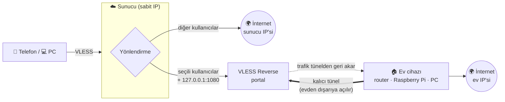

<div align="center">

# 🏠 xray-home-exit

**Sunucuna bağlan, ev internetinden çık.**

VDS'ine gelen trafiğin seçtiğin kısmını, evdeki router / Raspberry Pi / PC üzerinden
**ev IP'nle** internete çıkaran, tek komutla kurulan VLESS Reverse köprüsü.

[](https://github.com/emirhan-tan/xray-home-exit/releases/latest)
[](https://github.com/XTLS/Xray-core)
[](#-desteklenen-cihazlar)
[](#raspberry-pi)
[](#windows)
[](LICENSE)

[Hızlı kurulum](#-hızlı-kurulum) · [Nasıl çalışır](#-nasıl-çalışır) · [Cihazlar](#-desteklenen-cihazlar) · [Seçenekler](#%EF%B8%8F-seçenekler) · [SSS](#-sss) · [English](README.en.md)

</div>

---

## Neden?

Veri merkezi IP'leri pek çok sitede, oyunda ve uygulamada engelleniyor, captcha'ya takılıyor ya da
"yurt dışı/VPN" gibi görünüyor. Ev IP'n ise sıradan bir kullanıcı gibi görünüyor ama genelde
**CGNAT arkasında ve değişken**: dışarıdan erişilemiyor.

`xray-home-exit` bu ikisini birleştirir: istemcilerin **sabit IP'li sunucuna** bağlanır, seçtiğin
trafik ise **evdeki cihazın içeriden açtığı tünelden** ev IP'nle çıkar. Port yönlendirme, sabit IP,
DDNS gerekmez.

## ✨ Özellikler

|  |  |
|---|---|
| 🎯 **Kullanıcı bazlı** | x-ui / 3x-ui'deki yalnızca seçtiğin kullanıcılar eve gider; diğerleri sunucu IP'sinden çıkmaya devam eder. |
| 🔁 **Otomatik yedek hat** | Ev tüneli düşerse (elektrik, modem, ISS) trafik ~10 sn içinde sunucu IP'sine geçer; tünel gelince kendiliğinden eve döner. |
| 🧩 **x-ui ile uyumlu** | Panel kullanıcılarına dokunmaz; yalnızca Xray şablonuna ekleme yapar, önce doğrular, yedek alır, açılmazsa geri alır. |
| 🛡️ **Güvenli varsayılanlar** | REALITY şifreleme (alan adı/sertifika gerekmez), ev yerel ağına (modem paneli, 192.168.x) erişim engelli. |
| 🌐 **IPv4 / IPv6** | Varsayılan yalnızca IPv4 (sızıntı yok); `--ipv6` ile ev hattının IPv6'sı da açılabilir. |
| 📦 **Her yerde çalışır** | OpenWrt (opkg/apk), Raspberry Pi OS, Debian/Ubuntu, Alpine, Windows; arm64, armv7, armv6, armv5, mips, mipsel, x86, riscv64… |
| 🪶 **Hafif** | 256 MB RAM'li router'da ~30 MB RAM. Flash'ı küçük cihazlar için RAM modu. |
| 🤖 **Sunucu içi SOCKS5** | `127.0.0.1:1080` ile sunucudaki botlar, scriptler, `curl`, `proxychains` de ev IP'sini kullanır. |

## 🧭 Nasıl çalışır



1. Ev cihazı sunucuya **dışarıya doğru** bir bağlantı açar ve açık tutar (CGNAT sorun değil).
2. Sunucu, seçili trafiği bu bağlantının içinden eve gönderir ([Xray VLESS Reverse Proxy](https://xtls.github.io/en/document/level-2/vless_reverse.html)).
3. Ev cihazı trafiği kendi internetinden çıkarır; site ev IP'ni görür.
4. Tünel yoksa sunucu bunu 10 sn içinde fark eder ve trafiği kendi IP'sinden çıkarır.

## 🚀 Hızlı kurulum

### 1 · Sunucu

Ubuntu / Debian, root:

```bash
curl -fsSL https://raw.githubusercontent.com/emirhan-tan/xray-home-exit/main/server/install.sh | bash -s -- --users kullanici1,kullanici2
```

- **x-ui / 3x-ui varsa** otomatik algılanır. `--users` panelin "Email" alanındaki adlardır;
  listelemek için `… | bash -s -- users`.
- **x-ui yoksa** Xray kurulur ve sana telefon/PC için hazır bir bağlantı linki verilir.

Kurulumun sonunda ev cihazı için bir **`vless://…` köprü linki** ve hazır komutlar yazdırılır.

> [!WARNING]
> Köprü linkini gizli tut: linki bilen biri kendi cihazını "ev çıkışı" olarak bağlayıp seçili
> trafiği üzerine alabilir. Sızdıysa `--regen` ile yenile.

### 2 · Ev cihazı

Sunucunun yazdırdığı komutu çalıştır:

**OpenWrt · Raspberry Pi · Linux**
```sh
wget -qO- https://raw.githubusercontent.com/emirhan-tan/xray-home-exit/main/client/install.sh | sh -s -- 'vless://…'
```

**Windows** (Yönetici PowerShell)
```powershell
& ([scriptblock]::Create((irm https://raw.githubusercontent.com/emirhan-tan/xray-home-exit/main/client/install.ps1))) -Link 'vless://…'
```

### 3 · Kontrol

```console
$ bash install.sh status
Mod: xui   Köprü portu: 10086   Bağlı ev tüneli: 1
Çıkış IP'si (127.0.0.1:1080): 88.xxx.xxx.xxx   ← ev IP'n
Sunucu IP'si:                 45.xxx.xxx.xxx
```

### Belirli bir sürümü kurmak

Yukarıdaki komutlar her zaman en güncel `main` dalını kullanır. Sabit bir sürüm için
[Releases](https://github.com/emirhan-tan/xray-home-exit/releases) sayfasındaki dosyaları kullan:

```sh
V=v1.0.0
curl -fsSL https://github.com/emirhan-tan/xray-home-exit/releases/download/$V/server-install.sh | bash -s -- --users kullanici1
wget -qO- https://github.com/emirhan-tan/xray-home-exit/releases/download/$V/client-install.sh | sh -s -- 'vless://…'
```

Her sürümde dosyaların `SHA256SUMS.txt` özetleri de bulunur. Değişiklikler: [CHANGELOG.md](CHANGELOG.md).

## 📟 Desteklenen cihazlar

Tablodaki her satır, bu depodaki [`tests/chroot-matrix.sh`](tests/chroot-matrix.sh) ile gerçekten
kurulup **tünelden trafik geçirilerek** test edildi (qemu-user + chroot). ✅ işaretliler ayrıca
gerçek donanımda çalıştırıldı.

| Sistem | Mimari | Kurulum | Xray kaynağı |
|---|---|---|---|
| OpenWrt 25.12 | aarch64 ✅ (MT7981 router), mipsel | apk · procd | OpenWrt `xray-core` paketi |
| OpenWrt 24.10 | aarch64, armv7, mips, mipsel, x86_64, i386 | opkg · procd | resmi Xray sürümü |
| OpenWrt (küçük flash) | aarch64 — `--ram` | procd | her açılışta RAM'e indirilir |
| Raspberry Pi OS / Debian 12 | arm64 (Pi 3/4/5), armhf (Pi 2/3) | apt · systemd | resmi Xray sürümü |
| Alpine | armv6 (Pi Zero/1), riscv64 | apk · OpenRC | resmi Xray sürümü |
| Windows 10/11 | x64 ✅ (ARM64, x86) | Zamanlanmış görev | resmi Xray sürümü |

Mimari otomatik seçilir (`arm64-v8a`, `arm32-v7a/v6/v5`, `mips32(le)` softfloat, `mips64(le)`,
`64`, `32`, `riscv64`, `loong64`). Sistemde Xray ≥ 26 varsa o kullanılır.

<details>
<summary><b>OpenWrt ayrıntıları</b></summary>

- Servis: `/etc/init.d/home-exit {start|stop|restart}` · günlük: `logread -e xray`
- Bekçi (cron, 2 dk): bağlantı yoksa servisi yeniden başlatır.
- Dosyalar `sysupgrade` sırasında korunur.
- **Küçük flash (16/32 MB):** yer yoksa otomatik RAM moduna geçilir (`--ram` ile zorlanabilir).
  128 MB altı RAM önerilmez.
- **PassWall / OpenClash / sing-box kullanıyorsan:** köprü trafiği `mark 255` ile işaretlenir;
  şeffaf proxy kurallarında bu işareti hariç tut, yoksa ev çıkışı tekrar proxy'ye girer.

</details>

<details>
<summary id="raspberry-pi"><b>Raspberry Pi</b></summary>

Raspberry Pi OS Lite (32 veya 64 bit) kur, SSH'ı aç ve:

```sh
curl -fsSL https://raw.githubusercontent.com/emirhan-tan/xray-home-exit/main/client/install.sh | sudo sh -s -- 'vless://…'
```

`home-exit` systemd servisi ve 2 dakikalık bekçi zamanlayıcısı kurulur:
`systemctl status home-exit` · `journalctl -u home-exit -f`.
Pi Zero / Pi 1 (armv6) desteklenir; Pi'yi kablolu bağlamak tünel kararlılığını artırır.

</details>

<details>
<summary id="windows"><b>Windows</b></summary>

Xray, açılışta SYSTEM hesabıyla çalışan `xray-home-exit` zamanlanmış görevi olarak kurulur;
oturum açman gerekmez, kapanırsa 5 sn içinde yeniden başlar, ayrıca 2 dakikada bir bağlantı
denetlenir. Dosyalar `C:\ProgramData\home-exit` (yalnızca SYSTEM/Yöneticiler okuyabilir).
Kaldırmak için aynı komutu `-Uninstall` ile çalıştır.

Bilgisayar uyursa tünel düşer ve trafik sunucu IP'sine döner; 7/24 için router veya Pi önerilir.

</details>

## 🤖 Sunucudaki uygulamaları ev IP'siyle çalıştırmak

```bash
curl --socks5-hostname 127.0.0.1:1080 https://api.ipify.org     # ev IP'n
```

SOCKS desteklemeyen programlar için `proxychains4`:

```ini
# /etc/proxychains4.conf
strict_chain
proxy_dns
[ProxyList]
socks5 127.0.0.1 1080
```

```bash
proxychains4 -q node bot.js
```

## ⚙️ Seçenekler

<details open>
<summary><b>Sunucu</b> — <code>server/install.sh</code></summary>

| Komut | |
|---|---|
| `install` *(varsayılan)* | Kur / güncelle — tekrar çalıştırmak güvenli, anahtarlar korunur |
| `link` | Köprü linkini ve ev kurulum komutlarını yeniden yazdır |
| `status` | Bağlı ev tüneli ve çıkış IP'si |
| `users` | x-ui kullanıcılarını listele |
| `uninstall` | Kaldır (x-ui'de yalnızca eklenen parçalar silinir) |

| Seçenek | Varsayılan | Açıklama |
|---|---|---|
| `--users a,b` | – | x-ui: eve gidecek kullanıcılar |
| `--ipv6` / `--no-ipv6` | kapalı | Eve giden trafikte IPv6'ya izin ver (ev cihazına linkle iletilir) |
| `--fallback direct\|block` | `direct` | Ev tüneli yokken sunucu IP'si mi, engelle mi |
| `--port N` | `10086` | Ev cihazının bağlandığı port |
| `--socks-port N` | `1080` | Sunucu içi SOCKS5 (`0` = kapalı) |
| `--entry-port N` | `443` | x-ui yoksa: telefon/PC giriş portu |
| `--sni SITE` | otomatik | REALITY'nin taklit ettiği site (çalışan biri otomatik seçilir) |
| `--tls-cert F --tls-key F --sni ALANADI` | – | REALITY yerine kendi sertifikanla TLS |
| `--name AD` | `home-exit` | Aynı sunucuda birden fazla bağımsız köprü |
| `--dry-run` | – | Hiçbir şeyi değiştirmeden oluşacak ayarı doğrula |
| `--regen` | – | UUID/anahtarları yenile (ev cihazı yeniden kurulur) |

</details>

<details>
<summary><b>Ev cihazı</b> — <code>client/install.sh</code> · Windows'ta <code>-Parametre</code></summary>

| Seçenek | Açıklama |
|---|---|
| `'vless://…'` | Sunucunun verdiği köprü linki |
| `uninstall` · `status` | Kaldır · durum |
| `--ipv6` / `--no-ipv6` | IPv6 çıkışını aç/kapat (varsayılan: linkteki ayar) |
| `--allow-lan` | Sunucudan ev yerel ağına erişime izin ver (varsayılan: engelli) |
| `--ram` | OpenWrt: Xray'i flash yerine RAM'de tut |
| `--mark N` | Giden paket işareti (OpenWrt'de `255`, `0` = kapalı) |
| `--xray-version vX.Y.Z` | Belirli bir Xray sürümü |
| `--name AD` | Birden fazla sunucuya köprü |

</details>

## ❓ SSS

<details>
<summary><b>Ev internetimin hızı ne kadar etkilenir?</b></summary>

Yalnızca yönlendirdiğin trafik ev hattından geçer. Ölçümlerde ev ↔ sunucu arası ~4 ms ek gecikme
ve ev hattının upload hızına yakın verim görüldü. Upload hızın, eve yönlenen kullanıcıların
indirme hızının üst sınırıdır.

</details>

<details>
<summary><b>Ev IP'm değişirse / modem yeniden başlarsa?</b></summary>

Sorun değil. Ev cihazı tüneli kendisi açtığı için yeni IP'den yeniden bağlanır; arada geçen
birkaç saniyede trafik sunucu IP'sinden çıkar.

</details>

<details>
<summary><b>Birden fazla evden çıkış yapabilir miyim?</b></summary>

Evet: sunucuda her ev için ayrı `--name` ve `--port` ile kurulum yap, her evin cihazına kendi
linkini kur. Böylece örneğin `--name ev1 --users ali` ve `--name ev2 --users ayse` ile farklı
kullanıcılar farklı evlerden çıkar.

</details>

<details>
<summary><b>Neden reverse hatta <code>xtls-rprx-vision</code> yok?</b></summary>

Vision, TLS el sıkışmasını istemci → sunucu yönünde bekler; ters tünelde akış tersine döndüğü için
HTTPS siteler bozulur. Telefon → sunucu hattında vision kullanılmaya devam eder. Diğer teknik
notlar: [docs/teknik.md](docs/teknik.md).

</details>

## 🧪 Geliştirme ve test

- [`tests/chroot-matrix.sh`](tests/chroot-matrix.sh): ev betiğini 13 farklı sistem/mimaride
  qemu + chroot ile kurar ve tünelden gerçek trafik geçirir.
- [`tests/windows-admin-test.ps1`](tests/windows-admin-test.ps1): Windows görevlerini, yeniden
  başlatmayı ve kaldırmayı sınar.
- [`docs/teknik.md`](docs/teknik.md): el ile yapılandırma JSON'ları ve Xray 26 tuzakları.

## ⚖️ Sorumluluk

Bu araç kendi sunucun ve kendi ev bağlantın içindir. Ev IP'nden çıkan trafikten sen sorumlusun;
linki yalnızca güvendiğin kişilerle paylaş ve internet sağlayıcının sözleşmesine uy.

<div align="center">

MIT · [Xray-core](https://github.com/XTLS/Xray-core) üzerine kurulmuştur

</div>
