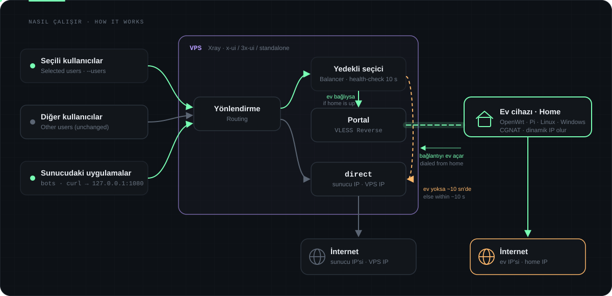

<div align="center">



<br/>

[](https://github.com/emirhan-tan/xray-home-exit/releases/latest)
[](https://github.com/XTLS/Xray-core)
[](#-test)
[](LICENSE)

**[🇹🇷 Türkçe](#turkce)** · **[🇬🇧 English](#english)**

</div>

<a id="turkce"></a>

## 🇹🇷 Türkçe

> **Sunucuna bağlan, ev internetinden çık.** VDS'ine gelen trafiğin seçtiğin kısmını evdeki router,
> Raspberry Pi veya PC üzerinden **ev IP'nle** internete çıkaran, tek komutla kurulan VLESS Reverse köprüsü.

### Neden?

Veri merkezi IP'leri pek çok sitede, oyunda ve uygulamada engelleniyor, captcha'ya takılıyor ya da
"VPN" olarak işaretleniyor. Ev IP'n sıradan bir kullanıcı gibi görünür ama genellikle **CGNAT
arkasında ve değişkendir**: dışarıdan ulaşılamaz.

`xray-home-exit` ikisini birleştirir: istemciler **sabit IP'li sunucuna** bağlanır, seçtiğin trafik
ise **evdeki cihazın içeriden açtığı tünelden** ev IP'nle çıkar. Port yönlendirme, sabit IP ya da DDNS gerekmez.

### ✨ Özellikler

| | |
|---|---|
| 🎯 **Kullanıcı bazlı** | x-ui / 3x-ui'de yalnızca seçtiğin kullanıcılar eve gider, diğerleri sunucu IP'sinden çıkmaya devam eder. |
| 🔁 **Otomatik yedek hat** | Ev tüneli düşerse (elektrik, modem, ISS) trafik ~10 sn içinde sunucu IP'sine geçer, tünel gelince kendiliğinden eve döner. |
| 🧩 **x-ui ile uyumlu** | Panel kullanıcılarına dokunmaz; yalnızca Xray şablonuna ekleme yapar. Önce doğrular, yedek alır, açılmazsa geri alır. |
| 🛡️ **Güvenli varsayılanlar** | REALITY şifreleme (alan adı/sertifika gerekmez), ev yerel ağına (modem paneli, 192.168.x) erişim engelli. |
| 🌐 **IPv4 / IPv6** | Varsayılan yalnızca IPv4 (sızıntı yok); `--ipv6` ile ev hattının IPv6'sı da açılır. |
| 📦 **Her yerde çalışır** | OpenWrt, Raspberry Pi OS, Debian/Ubuntu, Alpine, Windows; arm64, armv7, armv6, mips, x86, riscv64… |
| 🪶 **Hafif** | 256 MB RAM'li router'da ~30 MB RAM. Flash'ı küçük cihazlar için RAM modu. |
| 🤖 **Sunucu içi SOCKS5** | `127.0.0.1:1080` ile sunucudaki botlar, betikler, `curl` ve `proxychains` de ev IP'sini kullanır. |

### 🧭 Nasıl çalışır



1. Ev cihazı sunucuya **dışarıya doğru** bir bağlantı açar ve açık tutar (CGNAT sorun değil).
2. Sunucu seçili trafiği bu bağlantının içinden eve gönderir ([Xray VLESS Reverse](https://xtls.github.io/en/document/level-2/vless_reverse.html)).
3. Ev cihazı trafiği kendi internetinden çıkarır; karşı taraf ev IP'ni görür.
4. Tünel yoksa sunucu bunu 10 sn içinde fark eder ve trafiği kendi IP'sinden çıkarır.

### 🚀 Hızlı kurulum

**1 · Sunucu** (Ubuntu / Debian, root)

```bash
curl -fsSL https://raw.githubusercontent.com/emirhan-tan/xray-home-exit/main/server/install.sh | bash -s -- --users kullanici1,kullanici2
```

- **x-ui / 3x-ui varsa** otomatik algılanır. `--users` panelin "Email" alanındaki adlardır
  (listelemek için komutun sonuna `users` yaz).
- **x-ui yoksa** Xray kurulur ve sana telefon/PC için hazır bir bağlantı linki verilir.

Kurulumun sonunda ev cihazı için bir **`vless://…` köprü linki** ve hazır komutlar yazdırılır.

> [!WARNING]
> Köprü linkini gizli tut: linki bilen biri kendi cihazını "ev çıkışı" olarak bağlayıp seçili
> trafiği üzerine alabilir. Sızdıysa `--regen` ile yenile.

**2 · Ev cihazı** — sunucunun yazdırdığı komutu çalıştır:

```sh
# OpenWrt · Raspberry Pi · Linux (root)
wget -qO- https://raw.githubusercontent.com/emirhan-tan/xray-home-exit/main/client/install.sh | sh -s -- 'vless://…'
```

```powershell
# Windows (Yönetici PowerShell)
& ([scriptblock]::Create([Text.Encoding]::UTF8.GetString((New-Object Net.WebClient).DownloadData('https://raw.githubusercontent.com/emirhan-tan/xray-home-exit/main/client/install.ps1')))) -Link 'vless://…'
```

**3 · Kontrol**

```console
$ bash install.sh status
Mod: xui   Köprü portu: 10086   Bağlı ev tüneli: 1
Çıkış IP'si (127.0.0.1:1080): 88.xxx.xxx.xxx   ← ev IP'n
Sunucu IP'si:                 45.xxx.xxx.xxx
```

<details>
<summary><b>Belirli bir sürümü kurmak</b></summary>

Yukarıdaki komutlar her zaman en güncel `main` dalını kullanır. Sabit sürüm için
[Releases](https://github.com/emirhan-tan/xray-home-exit/releases) dosyalarını kullan
(her sürümde `SHA256SUMS.txt` vardır):

```sh
V=v1.0.0
curl -fsSL https://github.com/emirhan-tan/xray-home-exit/releases/download/$V/server-install.sh | bash -s -- --users kullanici1
wget -qO- https://github.com/emirhan-tan/xray-home-exit/releases/download/$V/client-install.sh | sh -s -- 'vless://…'
```

</details>

### 📟 Desteklenen sistemler



Her satır [`tests/chroot-matrix.sh`](tests/chroot-matrix.sh) ile gerçekten kurulup **tünelden trafik
geçirilerek** test edildi (qemu + chroot); ✅ işaretliler ayrıca gerçek donanımda çalıştırıldı.

| Sistem | Mimari | Kurulum | Xray kaynağı |
|---|---|---|---|
| OpenWrt 25.12 | aarch64 ✅, mipsel | apk · procd | OpenWrt `xray-core` paketi |
| OpenWrt 24.10 | aarch64, armv7, mips, mipsel, x86_64, i386 | opkg · procd | resmi Xray sürümü |
| OpenWrt (küçük flash) | aarch64 · `--ram` | procd | her açılışta RAM'e indirilir |
| Raspberry Pi OS / Debian 12 | arm64, armhf | apt · systemd | resmi Xray sürümü |
| Alpine | armv6 (Pi Zero/1), riscv64 | apk · OpenRC | resmi Xray sürümü |
| Windows 10/11 | x64 ✅ (ARM64, x86) | zamanlanmış görev | resmi Xray sürümü |

<details>
<summary><b>OpenWrt</b></summary>

- Servis: `/etc/init.d/home-exit {start|stop|restart}` · günlük: `logread -e xray`
- Bekçi (cron, 2 dk) bağlantı yoksa servisi yeniden başlatır; dosyalar `sysupgrade`'de korunur.
- Sistemde Xray ≥ 26 varsa o, yoksa OpenWrt `xray-core` paketi (≥ 26 ise), o da yoksa resmi sürüm kullanılır.
- **Küçük flash (16/32 MB):** yer yoksa otomatik RAM moduna geçilir (`--ram` ile zorlanabilir). 128 MB altı RAM önerilmez.
- **PassWall / OpenClash / sing-box:** köprü trafiği `mark 255` ile işaretlenir; şeffaf proxy
  kurallarında bu işareti hariç tut, yoksa ev çıkışı tekrar proxy'ye girer.

</details>

<details>
<summary><b>Raspberry Pi</b></summary>

Raspberry Pi OS Lite (32 veya 64 bit) kur, SSH'ı aç ve:

```sh
curl -fsSL https://raw.githubusercontent.com/emirhan-tan/xray-home-exit/main/client/install.sh | sudo sh -s -- 'vless://…'
```

`home-exit` systemd servisi ve 2 dakikalık bekçi zamanlayıcısı kurulur:
`systemctl status home-exit` · `journalctl -u home-exit -f`. Pi Zero / Pi 1 (armv6) desteklenir;
kablolu bağlantı tünel kararlılığını artırır.

</details>

<details>
<summary><b>Windows</b></summary>

Xray, açılışta SYSTEM hesabıyla çalışan `xray-home-exit` zamanlanmış görevi olarak kurulur;
oturum açman gerekmez, kapanırsa 5 sn içinde yeniden başlar, 2 dakikada bir bağlantı denetlenir.
Dosyalar `C:\ProgramData\home-exit` (yalnızca SYSTEM / Yöneticiler okuyabilir). Kaldırmak için aynı
komutu `-Uninstall` ile çalıştır. Bilgisayar uyursa tünel düşer ve trafik sunucu IP'sine döner;
7/24 için router veya Pi önerilir.

</details>

### 🤖 Sunucudaki uygulamaları ev IP'siyle çalıştırmak

```bash
curl --socks5-hostname 127.0.0.1:1080 https://api.ipify.org     # ev IP'n
```

SOCKS desteklemeyen programlar için `proxychains4` (`/etc/proxychains4.conf` → `socks5 127.0.0.1 1080`):

```bash
proxychains4 -q node bot.js
```

### ⚙️ Seçenekler

<details open>
<summary><b>Sunucu</b> — <code>server/install.sh</code></summary>

| Komut | |
|---|---|
| `install` *(varsayılan)* | Kur / güncelle; tekrar çalıştırmak güvenlidir, anahtarlar korunur |
| `link` | Köprü linkini ve ev kurulum komutlarını yeniden yazdır |
| `status` | Bağlı ev tüneli ve çıkış IP'si |
| `users` | x-ui kullanıcılarını listele |
| `uninstall` | Kaldır (x-ui'de yalnızca eklenen parçalar silinir) |

| Seçenek | Varsayılan | Açıklama |
|---|---|---|
| `--users a,b` | – | x-ui: eve gidecek kullanıcılar |
| `--ipv6` / `--no-ipv6` | kapalı | Eve giden trafikte IPv6 (ev cihazına linkle iletilir) |
| `--fallback direct\|block` | `direct` | Ev tüneli yokken sunucu IP'si mi, engelle mi |
| `--port N` | `10086` | Ev cihazının bağlandığı port |
| `--socks-port N` | `1080` | Sunucu içi SOCKS5 (`0` = kapalı) |
| `--entry-port N` | `443` | x-ui yoksa telefon/PC giriş portu |
| `--sni SITE` | otomatik | REALITY'nin taklit ettiği site |
| `--tls-cert F --tls-key F --sni ALANADI` | – | REALITY yerine kendi sertifikanla TLS |
| `--name AD` | `home-exit` | Aynı sunucuda birden fazla bağımsız köprü |
| `--dry-run` | – | Hiçbir şeyi değiştirmeden oluşacak ayarı doğrula |
| `--regen` | – | UUID/anahtarları yenile (ev cihazı yeniden kurulur) |

</details>

<details>
<summary><b>Ev cihazı</b> — <code>client/install.sh</code> · Windows'ta <code>-Parametre</code></summary>

| Seçenek | Açıklama |
|---|---|
| `'vless://…'` · `uninstall` · `status` | Kur · kaldır · durum |
| `--ipv6` / `--no-ipv6` | IPv6 çıkışını aç/kapat (varsayılan: linkteki ayar) |
| `--allow-lan` | Sunucudan ev yerel ağına erişime izin ver (varsayılan: engelli) |
| `--ram` | OpenWrt: Xray'i flash yerine RAM'de tut |
| `--mark N` | Giden paket işareti (OpenWrt'de `255`, `0` = kapalı) |
| `--xray-version vX.Y.Z` | Belirli bir Xray sürümü |
| `--name AD` | Birden fazla sunucuya köprü |

</details>

### ❓ SSS

<details>
<summary><b>Ev internetimin hızı ne kadar etkilenir?</b></summary>

Yalnızca yönlendirdiğin trafik ev hattından geçer. Ölçümlerde ev ↔ sunucu arasında ~4 ms ek gecikme
ve ev hattının yükleme hızına yakın verim görüldü. Eve yönlenen kullanıcıların indirme hızının üst
sınırı, ev hattının **yükleme** hızıdır.

</details>

<details>
<summary><b>Ev IP'm değişirse ya da modem yeniden başlarsa?</b></summary>

Sorun değil: ev cihazı tüneli kendisi açtığı için yeni IP'den yeniden bağlanır; aradaki birkaç
saniyede trafik sunucu IP'sinden çıkar.

</details>

<details>
<summary><b>Birden fazla evden çıkış yapabilir miyim?</b></summary>

Evet: sunucuda her ev için ayrı `--name` ve `--port` ile kurulum yap, her evin cihazına kendi
linkini kur. Örneğin `--name ev1 --users ali` ve `--name ev2 --users ayse`.

</details>

<details>
<summary><b>Neden reverse hatta <code>xtls-rprx-vision</code> yok?</b></summary>

Vision, TLS el sıkışmasını istemci → sunucu yönünde bekler; ters tünelde akış tersine döndüğü için
HTTPS siteler bozulur. Telefon → sunucu hattında vision kullanılmaya devam eder. Ayrıntılar:
[docs/teknik.md](docs/teknik.md).

</details>

### 🧪 Test

- [`tests/chroot-matrix.sh`](tests/chroot-matrix.sh): ev betiğini 13 sistem/mimaride qemu + chroot ile kurar ve tünelden gerçek trafik geçirir.
- [`tests/windows-admin-test.ps1`](tests/windows-admin-test.ps1): Windows görevlerini, yeniden başlatmayı ve kaldırmayı sınar.
- [`docs/teknik.md`](docs/teknik.md): el ile yapılandırma JSON'ları ve Xray 26 tuzakları · [`CHANGELOG.md`](CHANGELOG.md)

> [!NOTE]
> Bu araç kendi sunucun ve kendi ev bağlantın içindir. Ev IP'nden çıkan trafikten sen sorumlusun;
> linki yalnızca güvendiğin kişilerle paylaş ve internet sağlayıcının sözleşmesine uy.

<br/>

<a id="english"></a>

## 🇬🇧 English

> **Connect to your VPS, exit through your home internet.** A one-command VLESS Reverse bridge that
> sends the traffic you choose out through your router, Raspberry Pi or PC at home — **with your
> residential IP**.

### Why?

Datacenter IPs get blocked, captcha'd or flagged as "VPN" by many sites, games and apps. Your home IP
looks like a normal user — but it is usually **behind CGNAT and dynamic**, so nothing can reach it
from outside.

`xray-home-exit` combines both: clients connect to your **VPS with a static IP**, and the selected
traffic leaves through a **tunnel that your home device opens from the inside**. No port forwarding,
static IP or DDNS needed.

### ✨ Features

| | |
|---|---|
| 🎯 **Per-user routing** | With x-ui / 3x-ui only the users you pick exit at home; everyone else keeps the VPS IP. |
| 🔁 **Automatic failover** | Home tunnel down (power, modem, ISP)? Traffic moves to the VPS IP within ~10 s and returns home automatically. |
| 🧩 **x-ui friendly** | Panel users are untouched; only the Xray template is extended. Validated first, DB backed up, rolled back if x-ui fails to start. |
| 🛡️ **Safe defaults** | REALITY transport (no domain/certificate), home LAN (router panel, 192.168.x) blocked from the VPS side. |
| 🌐 **IPv4 / IPv6** | IPv4-only by default (no leaks); `--ipv6` enables your home IPv6 too. |
| 📦 **Runs everywhere** | OpenWrt, Raspberry Pi OS, Debian/Ubuntu, Alpine, Windows; arm64, armv7, armv6, mips, x86, riscv64… |
| 🪶 **Lightweight** | ~30 MB RAM on a 256 MB router; RAM mode for small-flash devices. |
| 🤖 **Local SOCKS5 on the VPS** | `127.0.0.1:1080` lets bots, scripts, `curl` and `proxychains` use your home IP. |

### 🧭 How it works

See the diagram above: the home device **dials out** to the VPS and keeps the connection open; the VPS
routes the selected traffic through it ([Xray VLESS Reverse](https://xtls.github.io/en/document/level-2/vless_reverse.html));
the home device sends it out to the internet with your home IP. If the tunnel is down, a health-checked
balancer falls back to the VPS IP within ~10 s.

### 🚀 Quick start

**1 · VPS** (Ubuntu / Debian, root)

```bash
curl -fsSL https://raw.githubusercontent.com/emirhan-tan/xray-home-exit/main/server/install.sh | bash -s -- --users user1,user2
```

x-ui / 3x-ui is detected automatically (`--users` = the panel's "Email" field; append `users` to list
them). Without x-ui, a standalone Xray is installed and a ready client link for your phone/PC is
printed. Either way you get a **`vless://…` bridge link** for the home device.

> [!WARNING]
> Keep the bridge link secret — anyone holding it can attach their own device as the "home exit".
> Rotate it with `--regen` if it leaks.

**2 · Home device** — run the command the VPS printed:

```sh
# OpenWrt · Raspberry Pi · Linux (root)
wget -qO- https://raw.githubusercontent.com/emirhan-tan/xray-home-exit/main/client/install.sh | sh -s -- 'vless://…'
```

```powershell
# Windows (Administrator PowerShell)
& ([scriptblock]::Create([Text.Encoding]::UTF8.GetString((New-Object Net.WebClient).DownloadData('https://raw.githubusercontent.com/emirhan-tan/xray-home-exit/main/client/install.ps1')))) -Link 'vless://…'
```

**3 · Check** — `bash install.sh status` on the VPS shows the connected tunnel and the exit IP.

Pinned versions: use the files on the [Releases](https://github.com/emirhan-tan/xray-home-exit/releases)
page (`…/releases/download/v1.0.0/server-install.sh`, `client-install.sh`, `client-install.ps1`, `SHA256SUMS.txt`).

### 📟 Supported systems

Every row was installed and verified to carry real traffic through the tunnel with
[`tests/chroot-matrix.sh`](tests/chroot-matrix.sh) (qemu + chroot); ✅ = also on real hardware.

| System | Architectures | Init |
|---|---|---|
| OpenWrt 25.12 | aarch64 ✅, mipsel | apk · procd |
| OpenWrt 24.10 | aarch64, armv7, mips, mipsel, x86_64, i386, RAM mode | opkg · procd |
| Raspberry Pi OS / Debian 12 | arm64, armhf | systemd |
| Alpine | armv6 (Pi Zero/1), riscv64 | OpenRC |
| Windows 10/11 | x64 ✅ (ARM64, x86) | scheduled task |

**OpenWrt:** `/etc/init.d/home-exit`, cron watchdog, survives `sysupgrade`; automatic RAM mode on
small flash; traffic is marked `255` so PassWall/OpenClash rules can exclude it.
**Raspberry Pi:** systemd service `home-exit` + 2-minute watchdog timer, Pi Zero → Pi 5.
**Windows:** SYSTEM scheduled task, restarts within 5 s, files in `C:\ProgramData\home-exit`;
uninstall with `-Uninstall`.

### ⚙️ Options

**VPS:** `install | link | status | users | uninstall` · `--users a,b` · `--ipv6` / `--no-ipv6` ·
`--fallback direct|block` · `--port` (10086) · `--socks-port` (1080, 0 = off) · `--entry-port` (443) ·
`--sni` · `--tls-cert F --tls-key F --sni DOMAIN` · `--name` · `--dry-run` · `--regen`

**Home device:** `'vless://…' | status | uninstall` · `--ipv6` / `--no-ipv6` · `--allow-lan` ·
`--ram` · `--mark N` · `--xray-version vX.Y.Z` · `--name`

### ❓ FAQ

- **Speed?** Only routed traffic uses your home line; measured ~4 ms extra latency. The download speed
  of routed users is capped by your home **upload** speed.
- **Home IP changes / modem reboots?** The home device reconnects by itself; meanwhile traffic uses the VPS IP.
- **Several homes?** Install one bridge per home on the VPS with its own `--name` and `--port`.
- **Why no `xtls-rprx-vision` on the reverse link?** Vision expects the TLS handshake client → server;
  on a reverse tunnel the direction flips and HTTPS breaks. Details in [docs/teknik.md](docs/teknik.md) (Turkish; the JSON examples are universal).

> [!NOTE]
> Meant for your own server and your own home connection. You are responsible for traffic leaving your
> home IP — share the link only with people you trust and respect your ISP's terms.

<div align="center">
<br/>
<sub>MIT · built on <a href="https://github.com/XTLS/Xray-core">Xray-core</a></sub>
</div>
